# claudegrid

A Claude Code mod: a Tron-style HUD for Claude Code. It records every session in detail, shows your limits and spend before they surprise
you, tracks subagents live, and has a light-cycle game for the minutes Claude is working.

Needs Claude Code 2.1.287 or later. Terminal only for the drawings (it uses the Raster element); other surfaces get a text line.

<!-- SCREENSHOTS: the images under docs/screenshots/ are placeholders. They are renderings made from this mod's own drawing code with
     invented data (cards like SHOP-2417, projects Acme-Storefront and Acme-Payments), not captures from a live terminal.
     To replace one, drop a real capture in with the same filename. -->
> Screenshots in this README are placeholders rendered with invented data. Replace them with captures from your own terminal (same filenames in `docs/screenshots/`).

## Enable function hooks (required)
claudegrid only works with `CLAUDE_CODE_ENABLE_FUNCTION_HOOKS=1` set. Do it one of two ways.

**For the current terminal session only.** It lasts until you close that window; check with `echo $CLAUDE_CODE_ENABLE_FUNCTION_HOOKS`, which should print `1`.

    export CLAUDE_CODE_ENABLE_FUNCTION_HOOKS=1
    claude --plugin-dir /path/to/claudegrid

**Globally.** Either add it to your shell profile:

    echo 'export CLAUDE_CODE_ENABLE_FUNCTION_HOOKS=1' >> ~/.zshrc
    source ~/.zshrc

or put it in Claude Code's own settings file, `~/.claude/settings.json`, under an `env` key:

    {
      "env": {
        "CLAUDE_CODE_ENABLE_FUNCTION_HOOKS": "1"
      }
    }

Restart Claude Code after changing either global setting.

## Install
    claude --plugin-dir /path/to/claudegrid
    claude plugin validate /path/to/claudegrid      # lists every event it hooks and every API call it makes
    claude plugin test /path/to/claudegrid

A mod runs with your machine access. Read `claude plugin validate` output before installing any mod, this one included.

## What you get
**Band above the prompt.** Card, session, turn, clock. 5-hour and 7-day limit bars with a marker for how far through each
window you are. Tokens (out, in, cache), cost, today's spend against your budget,
context, model, tool/skill/agent counts, and how many subagents are running.

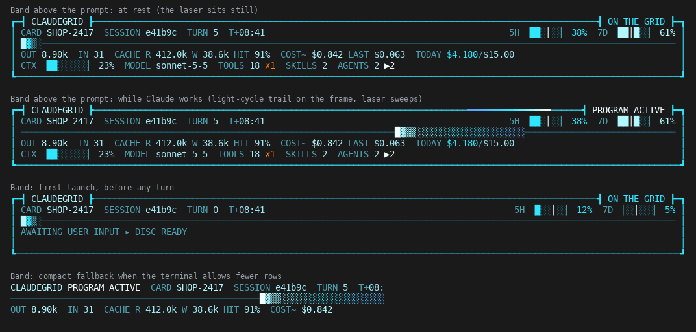
*The band: at rest (the laser sits still), while Claude works, on first launch, and the compact fallback for short terminals.*

**`/grid` console** (Esc closes; `1` ledger, `2` GRID RUN, `3` SUMMARY, `t` theme):
data log of every tool call, AGENT RADAR (one live line per subagent, with a running clock and a tick when it returns),
per-turn token bars, tool time, session facts, lifetime cost of the current Jira card, today's spend, and a step table
with every model request's token split and stop reason.

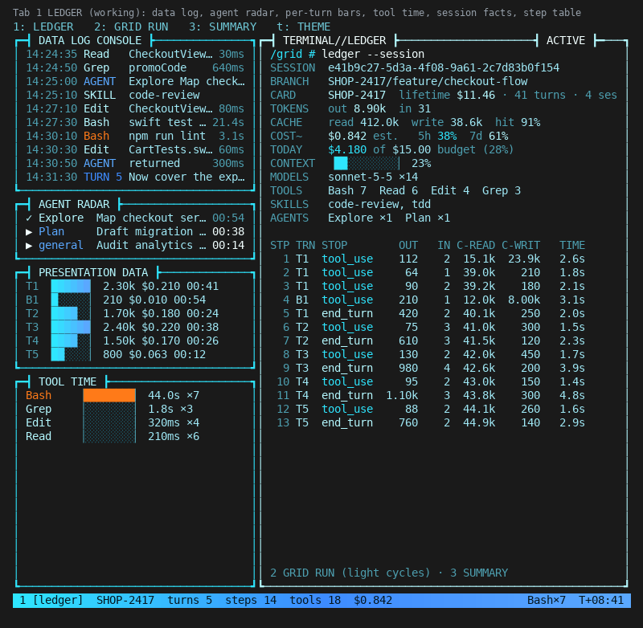
*Tab 1, LEDGER: data log, agent radar, per-turn bars, tool time, session facts and the step table.*

**GRID RUN.** Light cycles against Clu. `w a s d` steer, `p` pause, `g` new run, `l` level (easy, normal, hard, insane).
It pauses and says CLAUDE DONE when Claude finishes a turn, so you never miss a reply.

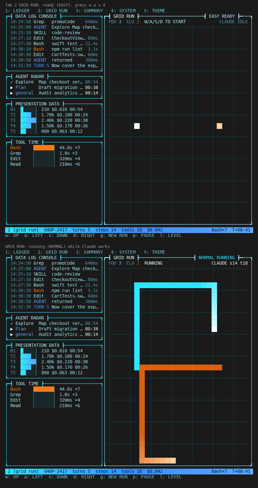
*Tab 2, GRID RUN: ready (easy), and running (normal) while Claude works.*

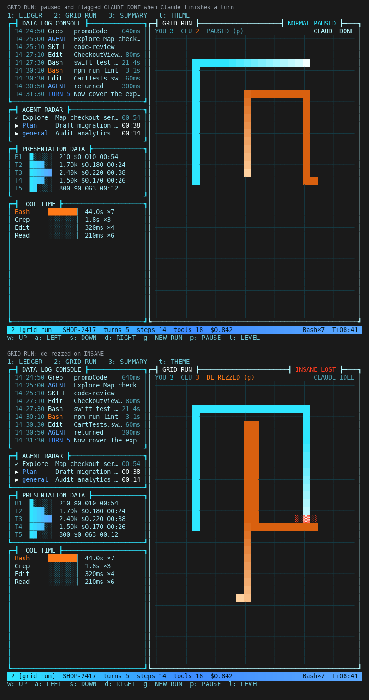
*Paused and flagged CLAUDE DONE when Claude finishes a turn; de-rezzed on insane.*

**Alerts** (toasts, once per window): limits at 80% and 90%,
daily budget at 80% and 100%, and each subagent finishing.

## Commands
`/grid help` lists these. If another mod already owns `/grid`, this one registers `/claudegrid`, then `/cgrid`.
| command | does |
| --- | --- |
| `/grid` | open the console |
| `/grid text` | session summary in the transcript |
| `/grid tools`, `skills`, `agents`, `turn N` | text views |
| `/grid summary [dimension] [CARD-KEY] [range]` | the SUMMARY tab: metrics across **all** your sessions (see below) |
| `/grid card [KEY]` | one Jira card across every session (default: this session's) |
| `/grid cards` | every card, by cost |
| `/grid export [path]` | every turn as CSV for a spreadsheet (default `~/.claude/claudegrid/claudegrid.csv`) |
| `/grid today` | spend today, across sessions |
| `/grid budget N` / `off` | daily budget in USD |
| `/grid theme [soft\|neon]` | SOFT (default, light blue) or the bolder NEON |
| `/grid prompts on\|off` | save prompt text in the ledger files |
| `/grid billing` | how this session is billed, and what COST means |
| `/grid probe` | shape of what this build exposes to a mod (no values) |

Hotkeys in the pane only work while it has keyboard focus: open it with `/grid` when the prompt is empty, or Ctrl+X then Tab.

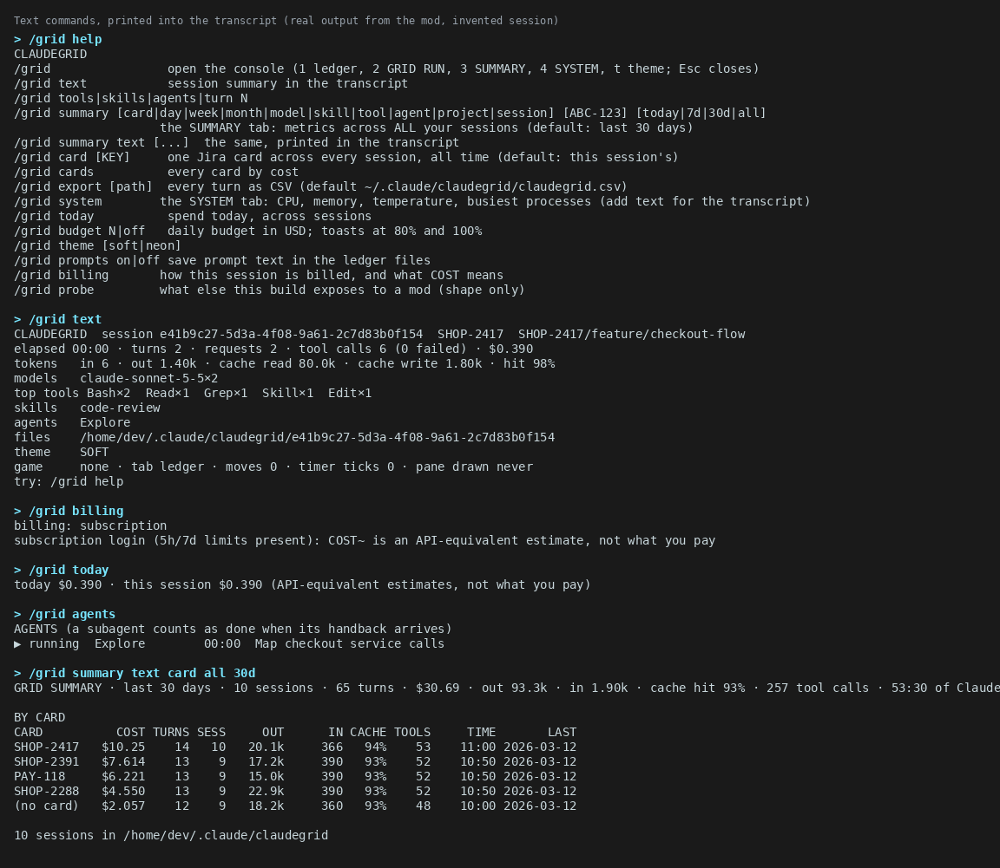
*The text commands (`help`, `text`, `billing`, `today`, `agents`, `summary text`) print into the transcript.*

## The central ledger and the SUMMARY tab
Every completed turn becomes one compact row (card, branch, project, models, tokens, cost, tools, skills, agents, time).
Each session keeps its rows in `~/.claude/claudegrid/<session>/rows.json`; the summary reads every session's file, so sessions never
write to the same place. Sessions recorded before this existed are rebuilt from their `turn-NNNN.json` files the first time
you open it (and cached).

Open it with `/grid summary` (or press `3` in the console).

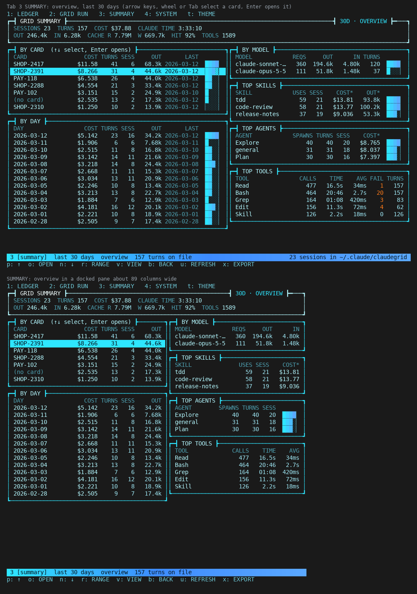
*Tab 3, SUMMARY, overview: the by-card table (n / p select, o opens) with by-day, by-model, top skills and top tools beside it.*

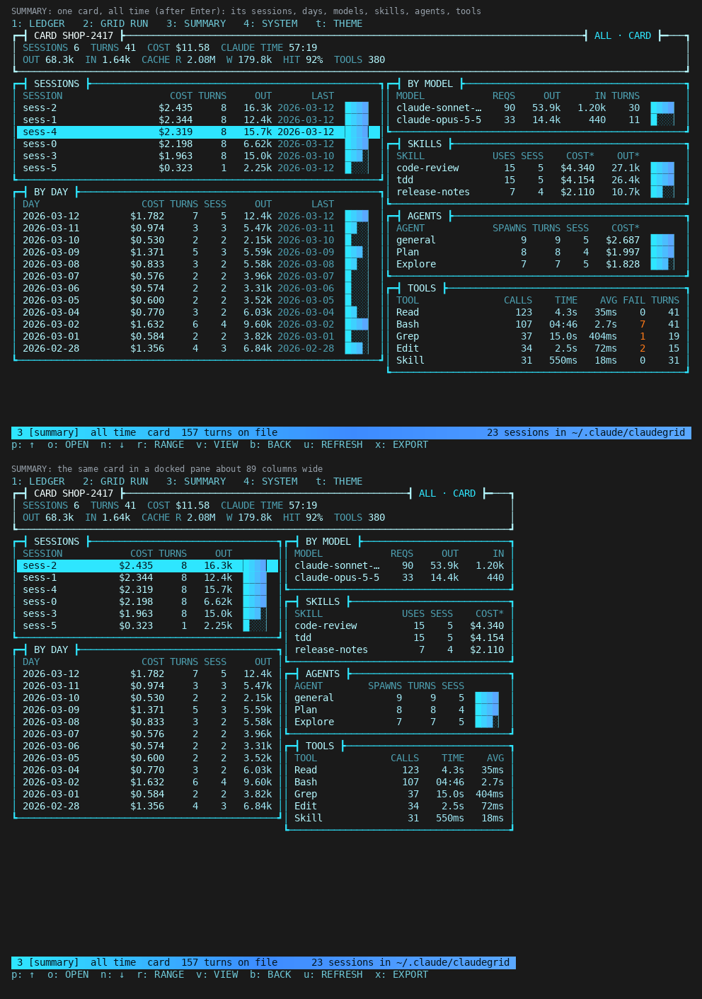
*One card (after `o`): its sessions, days, models, skills and tools.*

Keys, while the pane has focus:

| key | does |
| --- | --- |
| `r` | range: 30 days, all time, today, 7 days |
| `v` | view: overview, card, day, model, skill, agent, tool, project |
| `n` / `p` | select the next / previous row |
| `o` | open the selected card (its sessions, days, models, skills, agents, tools) |
| `b` | back to the overview |
| `u` | reload from disk (it also refreshes itself every minute) |
| `x` | export every turn as CSV to `~/.claude/claudegrid/claudegrid.csv` |

Commands that open it pre-filtered, in any order: `/grid summary [card|day|week|month|model|skill|tool|agent|project|session] [ABC-123] [today|7d|2w|30d|all]`,
`/grid card ABC-123` (that card, all time), `/grid cards` (the by-card view). Add `text` for the transcript version:
`/grid summary text skill 7d`. `/grid export [path]` writes the CSV directly.

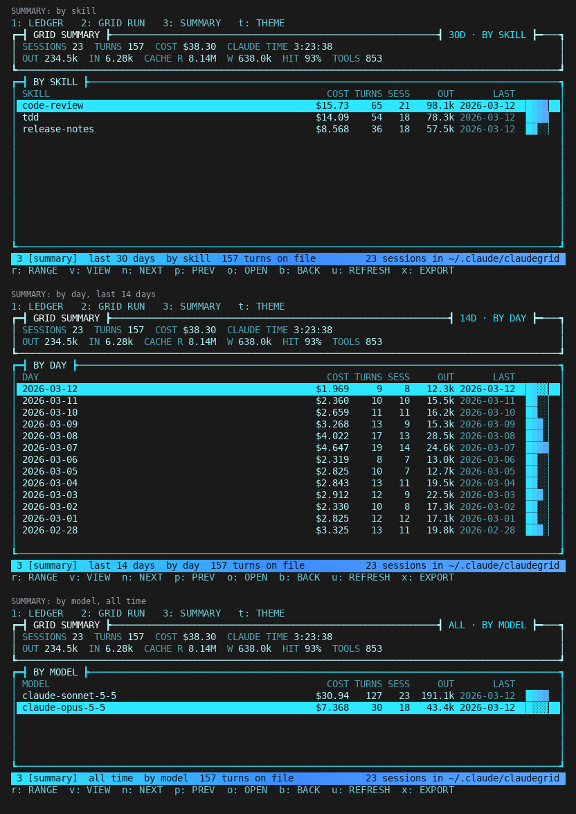
*Other views (`v`): by skill, by day (last 14 days) and by model.*

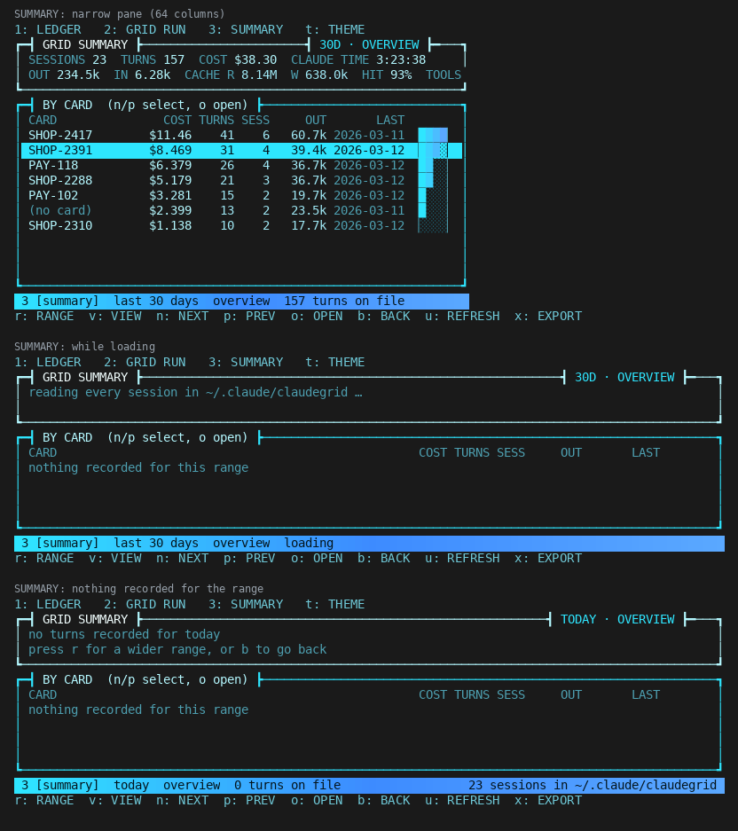
*A narrow pane, loading, and a range with nothing recorded.*

Skill, tool, agent and model tables count a turn once under each one it used, so those rows add up to more than the total.
Cost per row is read from Claude Code after the turn, so a background subagent's spend can land in a neighbouring turn; card and
day totals are unaffected. The live band, budget and `/grid today` use a faster running total kept in the mod's own store, so they
can differ slightly from the summary for days before this version.

## Themes
`t` in the pane, or `/grid theme [soft|neon]`. SOFT (default) is the cool-blue look with a touch of neon on your terminal's own background.
NEON is the bolder version: near-black panels, a glow inside the frames, pink and lime accents. The choice is remembered. Needs a true-colour terminal.

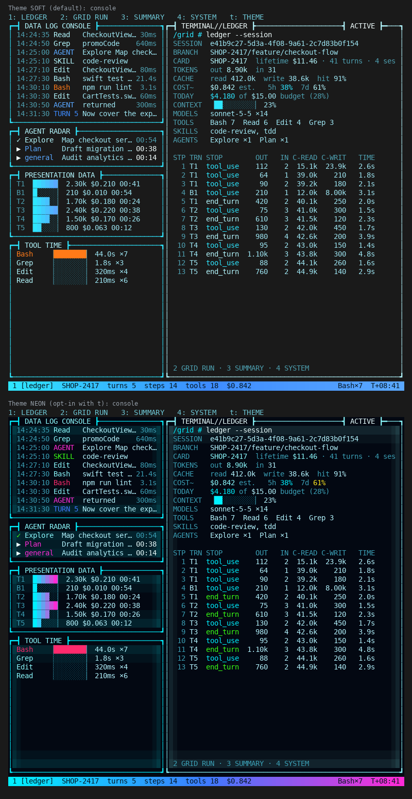
*The LEDGER console in SOFT (top) and NEON (bottom).*

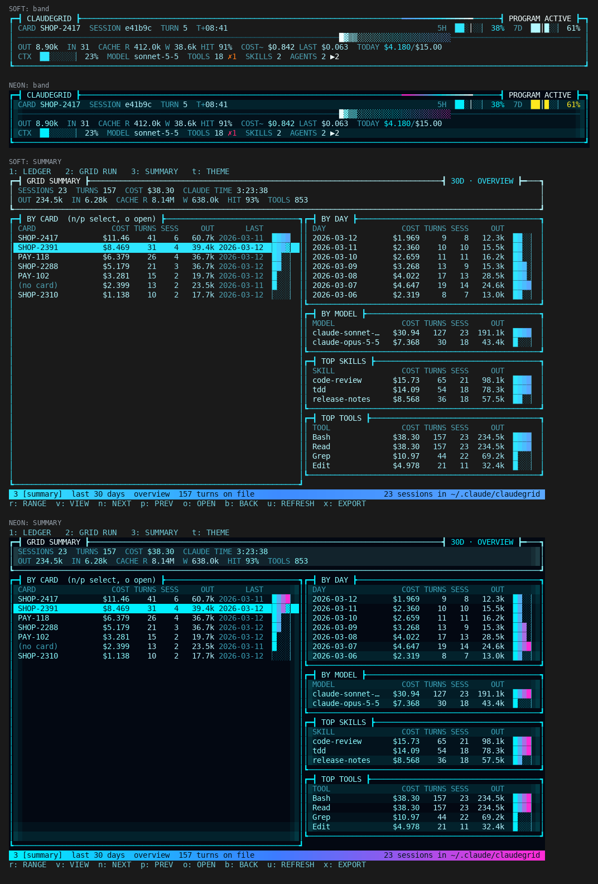
*The band and the SUMMARY tab in both themes.*

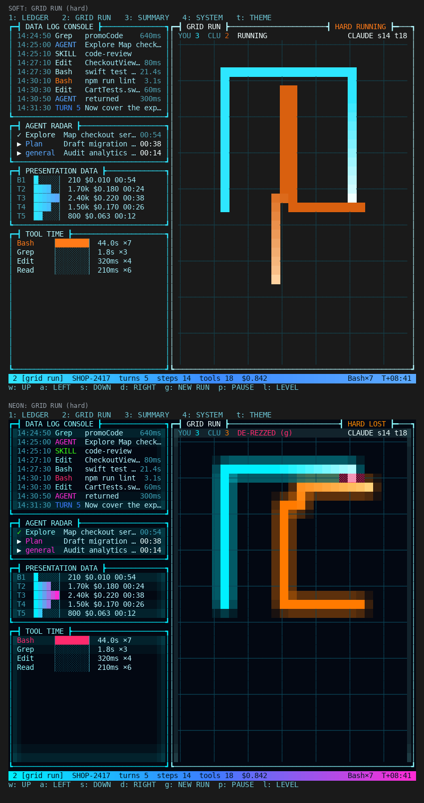
*GRID RUN in both themes: trails burn white-hot at the head and settle to the cycle colour.*

## Files
`~/.claude/claudegrid/<sessionId>/turn-0001.json`, `bg-0001.json` (background subagent turns), `rows.json` (the compact rows) and `session.json`.
`~/.claude/claudegrid/claudegrid.csv` appears when you run `/grid export`.
Per turn: prompt (trimmed to 200 characters), Jira card, branch, every model request (model, effort, stop reason, tool uses,
input, output, cache read, cache write, time), every tool call (name, source, tool id, one redacted argument line, wall time,
result size, estimated result tokens), skills, subagents (type, model, parent model, background, fork), duration, the engine's
own usage total, and cost. `schemaVersion` is in every file. Token counts are exact API numbers; result-token figures are
estimates; tool time includes permission waits.
Cross-session books live in the mod's own `$.store`: spend per day and totals per Jira card.

## Privacy
Everything stays on your machine. To tell what the cost figure means, the mod checks whether `ANTHROPIC_API_KEY` (or the Bedrock/Vertex flags)
is set. `$.env.get` hands the value to the mod, which only tests that it is non-empty and discards it: never stored, logged, written or shown.
`claude plugin validate` will list those variable names. On a subscription login `COST` is shown as `COST~`: an API-equivalent estimate, not what you pay.
`/grid probe` and `session.json -> probe` record the shape of what this build exposes (key names only, never settings values). `/grid prompts off` stops saving prompt text. Tool arguments are stored as a single line
with obvious secrets (bearer tokens, `token=`, `password=`, `sk-` keys) redacted; never raw input.
The Jira card comes from your branch name (`feature/ABC-123-thing`), falling back to a key in your prompt.

## Troubleshooting
`/grid text` ends with a `game` line (run state, timer ticks, when the pane was last drawn) and any `last error`.
`session.json` has `seenFields`: the fields each event actually carried, for checking against your Claude Code version.
A subagent counts as finished when its handback event arrives; events carry no agent id, so with several running at once
the oldest running one is marked done first.

## Tuning
`hooks/game.ts`: `LEVELS` (speed per level), `HARD_FOCUS`. `hooks/canvas.ts`: themes.

MIT licensed. Copyright (c) 2026 Jatin Mishra.

## Disclaimer
claudegrid is an independent community project. It is not affiliated with, endorsed by or sponsored by Anthropic or The Walt Disney Company.
Claude and Claude Code are trademarks of Anthropic. Tron is a trademark of Disney Enterprises, Inc.; this project only borrows the look
(neon grid, light cycles) as a homage, and contains no Disney artwork, sound or code.
