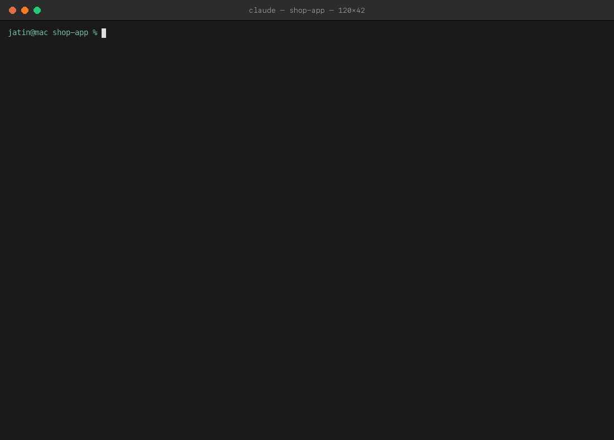
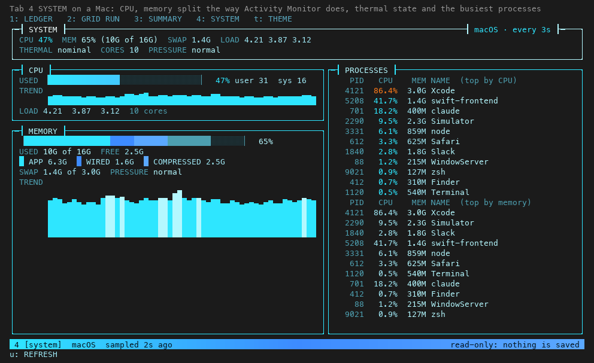

# claudegrid

A Tron-style HUD for Claude Code. It records every session in detail, shows your limits and spend before they surprise
you, tracks subagents live, and has a light-cycle game for the minutes Claude is working.

Needs Claude Code 2.1.287 or later. Terminal only for the drawings (it uses the Raster element); other surfaces get a text line.

## Install
    claude --plugin-dir /path/to/claudegrid
    claude plugin validate /path/to/claudegrid      # lists every event it hooks and every API call it makes

A mod runs with your machine access. Read the `validate` output before installing any mod, this one included.

## What you get
**Band above the prompt.** Card, session, turn, clock; 5-hour and 7-day limit bars; tokens, cost, today's spend against
your budget, context, model, and how many subagents are running.

### LEDGER: see exactly what Claude did
Press `/grid` (Esc closes; `1` ledger, `2` GRID RUN, `3` SUMMARY, `4` SYSTEM, `t` theme). A data log of every tool call,
a live line per subagent, per-turn token bars, tool time, and a step table with every model request's token split.

### SUMMARY: cost and usage across all sessions
Cost, tokens and tools by card, day, model, skill, agent, tool or project. `↑` `↓` select, `Enter` opens, `v` changes view, `r` changes range.

### SYSTEM: what your machine is doing
CPU, memory, thermal state and the busiest processes, sampled every 3 seconds while the tab is open.
Useful when an agent starts a build or the simulator.

### GRID RUN: a light-cycle game for while Claude works
Light cycles against Clu. `w a s d` steer, `p` pause, `g` new run, `l` level. It pauses and says CLAUDE DONE
when Claude finishes a turn, so you never miss a reply.

**Alerts** (toasts, once per window): limits at 80% and 90%, daily budget at 80% and 100%, each subagent finishing.

## Commands
`/grid help` lists these. If another mod already owns `/grid`, this one registers `/claudegrid`, then `/cgrid`.

| command | does |
| --- | --- |
| `/grid` | open the console |
| `/grid text` | session summary in the transcript |
| `/grid summary [dimension] [CARD-KEY] [range]` | the SUMMARY tab, pre-filtered (add `text` for the transcript version) |
| `/grid card [KEY]`, `/grid cards` | one Jira card across every session, or every card by cost |
| `/grid system` | the SYSTEM tab (`/grid system text` for the transcript) |
| `/grid export [path]` | every turn as CSV (default `~/.claude/claudegrid/claudegrid.csv`) |
| `/grid today`, `/grid budget N\|off` | spend today; daily budget in USD |
| `/grid theme [soft\|neon]` | SOFT (default) or the bolder NEON |
| `/grid prompts on\|off` | save prompt text in the ledger files |
| `/grid billing`, `/grid probe` | how this session is billed; what this build exposes to a mod |

Hotkeys only work while the pane has keyboard focus: open it with `/grid` when the prompt is empty, or Ctrl+X then Tab.

## Data
Every completed turn is one row in `~/.claude/claudegrid/<session>/rows.json`, with full detail in `turn-NNNN.json`
next to it. The SUMMARY reads every session's file and stays live: other sessions are picked up within 15 seconds while the
tab is on screen, and nothing is scanned while the pane is closed. Cross-session books (spend per day, totals per card) live
in the mod's own `$.store`.

Token counts are exact API numbers; per-tool result tokens are estimates; tool time includes permission waits. Cost is
reported for the whole session, so it is not split per tool or model. On a subscription login it shows as `COST~`, an
API-equivalent estimate rather than what you pay.

The SYSTEM tab runs read-only commands as you (`top`, `vm_stat`, `sysctl`, `pmset`, `ps` on a Mac; `/proc` and `ps` on
Linux). It shows no temperature, only the thermal state on a Mac. The macOS path is tested against sample output, not on a Mac;
if a number looks wrong, `/grid system text` prints the readings.

## Privacy
Everything stays on your machine. To tell what the cost figure means, the mod checks whether `ANTHROPIC_API_KEY` (or the
Bedrock/Vertex flags) is set; it only tests that the value is non-empty and discards it. Prompts are trimmed to 200
characters (`/grid prompts off` stops saving them), tool arguments are stored as one redacted line, and process names
are shown on screen only. The Jira card comes from your branch name (`feature/ABC-123-thing`), falling back to a key in your prompt.

## Troubleshooting
`/grid text` ends with a `game` line and any `last error`. `session.json` has `seenFields`, the fields each event actually
carried, for checking against your Claude Code version. Events carry no agent id, so with several subagents running the
oldest is marked done first.

## Tuning
`hooks/game.ts`: `LEVELS`, `HARD_FOCUS`. `hooks/canvas.ts`: themes.

MIT licensed. Copyright (c) 2026 Jatin Mishra.

## Disclaimer
claudegrid is an independent community project. It is not affiliated with, endorsed by or sponsored by Anthropic or The Walt Disney Company.
Claude and Claude Code are trademarks of Anthropic. Tron is a trademark of Disney Enterprises, Inc.; this project only borrows the look
(neon grid, light cycles) as a homage, and contains no Disney artwork, sound or code.
